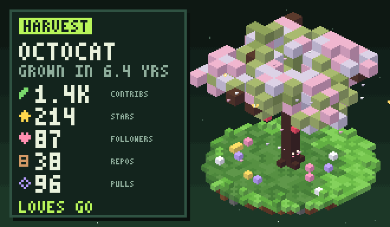

# harvest

A little animated voxel tree that grows from your GitHub stats.



Add it to your profile README:

```md

```

The canopy grows with your contributions, the trunk with your account age, and you get apples for stars, blossoms for followers, flowers for repos and butterflies for pull requests.

## Run locally

```bash
go run ./cmd/harvest render -user YOUR_USERNAME
go run ./cmd/harvest serve
```

Set `GITHUB_TOKEN` to include contribution counts.

Written in Go.
